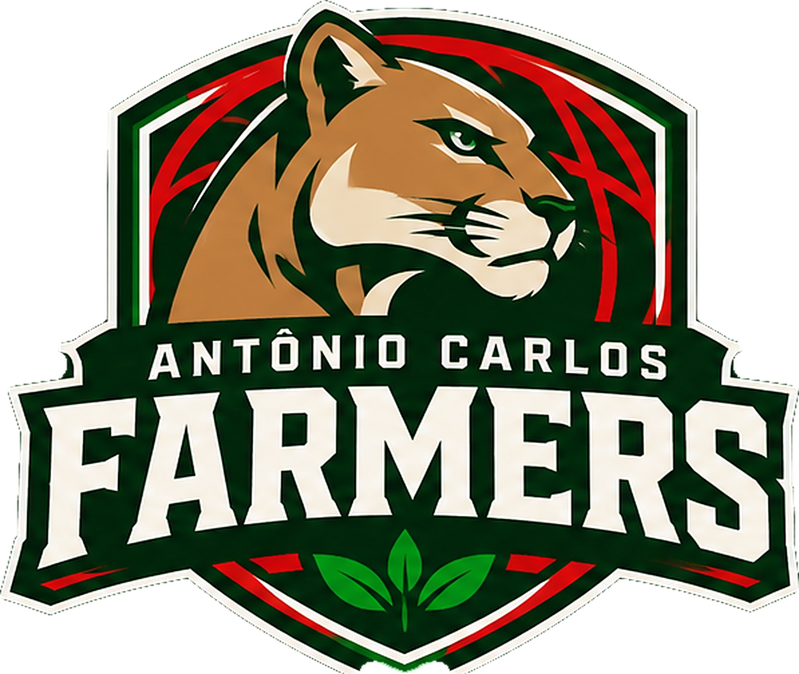

<p align="center">
  
</p>

<h1 align="center">Antônio Carlos Farmers</h1>

<p align="center">
  Projeto social de basquete em Antônio Carlos, Santa Catarina.<br>
  <strong>Basquete que planta futuro.</strong>
</p>

<p align="center">
  <a href="https://antonio-carlos-farmers.vercel.app">🌐 antonio-carlos-farmers.vercel.app</a>
</p>

---

## Sobre

O Farmers nasceu de um grupo de amigos que joga basquete em Antônio Carlos e decidiu abrir a quadra para a cidade inteira. A associação (em formação) quer levar treino, disciplina e convivência para jovens e adultos.

- **Mascote:** o leão-baio, felino nativo das matas do Sul
- **Folhas:** homenagem à agricultura da cidade (os *Farmers*)
- **Turmas iniciais:** Sub-15, Sub-17 e Adulto

## Estrutura do repositório

```
.
├── imagens/            Identidade visual
│   ├── logos/          Escudo, circular, mascote e monograma (fundo branco, escuro e transparente)
│   ├── impressos/      Bandeira, faixa 3x0,9 m e backdrop de entrevistas
│   ├── mockups/        Uniforme, quadra e adesivos
│   ├── redes-sociais/  Avatar, capa e posts de dia de jogo
│   ├── adesivos/
│   └── fonte/          Script que gera o mockup do uniforme
└── site/               Site institucional (Next.js 16)
```

## Paleta oficial

| Cor | Hex | Uso |
|---|---|---|
| 🟩 Verde | `#0E3A1E` | Cor principal, fundos e uniforme fora |
| ⬜ Creme | `#F3EBDD` | Fundos claros e uniforme casa |
| 🟥 Vermelho | `#D7080A` | Detalhes, contornos e chamadas |
| 🟫 Caramelo | `#BC7B3D` | Leão-baio e textos de apoio |

## Site

Páginas: **Início**, **Sobre**, **Turmas**, **Apoie** e **Pré-inscrição** (enviada pelo WhatsApp, com consentimento para menores).

```bash
cd site
npm install
npm run dev
```

Contatos, chave PIX e turmas ficam todos em [`site/src/lib/site.js`](site/src/lib/site.js). Mais detalhes no [README do site](site/README.md).

### Publicação

Todo push na branch `main` publica sozinho na Vercel em cerca de 1 minuto.

**Pelo celular:**
- edite `site/src/lib/site.js` no app do GitHub, ou
- peça a alteração ao Claude em [claude.ai/code](https://claude.ai/code) neste repositório.

## Uniforme

O mockup do uniforme (modelo 3) é gerado por código. Para trocar número, nome ou cores, edite o topo de [`imagens/fonte/gerar_uniforme.py`](imagens/fonte/gerar_uniforme.py) e rode:

```bash
python imagens/fonte/gerar_uniforme.py
```

- **Regata frente:** FARMERS em arco e número
- **Regata costas:** patrocínio em cima, nome reto, número e patrocínio embaixo
- **Calção:** escudo na perna direita (de quem veste), patrocínio na esquerda e nas costas

## Próximos passos

- [ ] Formalizar a associação (estatuto, ata, CNPJ, conta PJ)
- [ ] Preencher WhatsApp, Instagram e PIX no site
- [ ] Definir horários e locais das turmas
- [ ] Registrar domínio próprio
- [ ] Página de transparência e notícias
- [ ] Área do atleta integrada ao BasqueteAC
